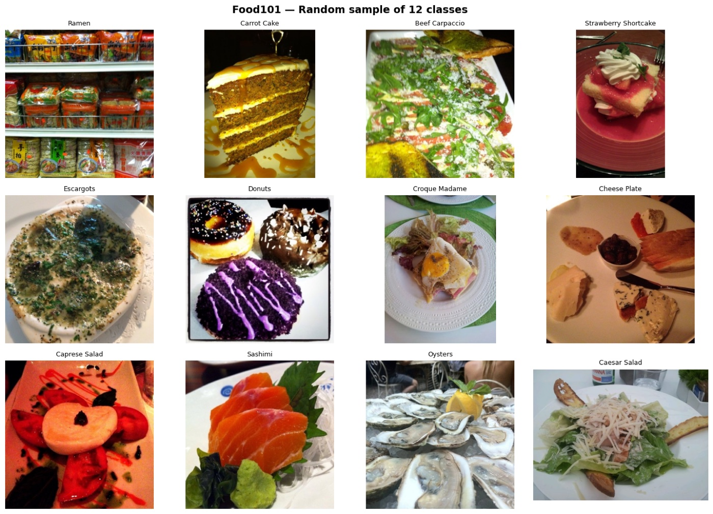
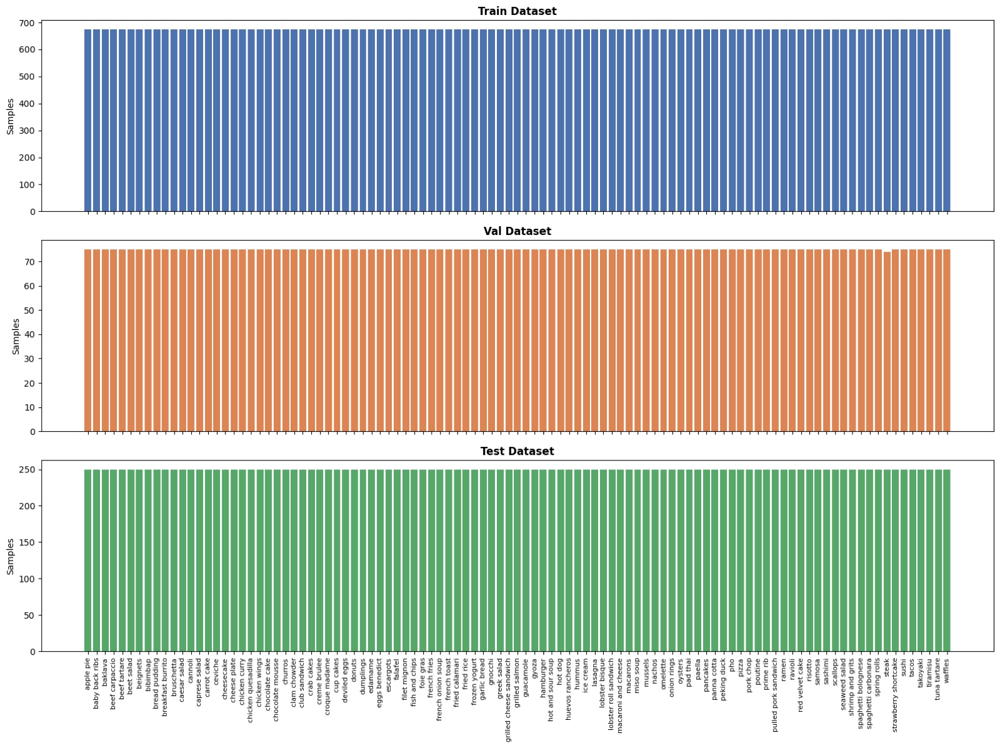
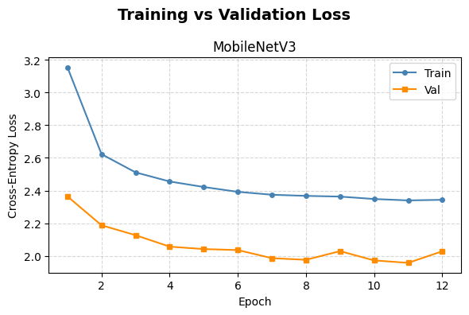
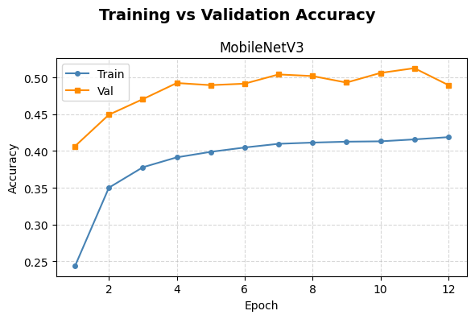
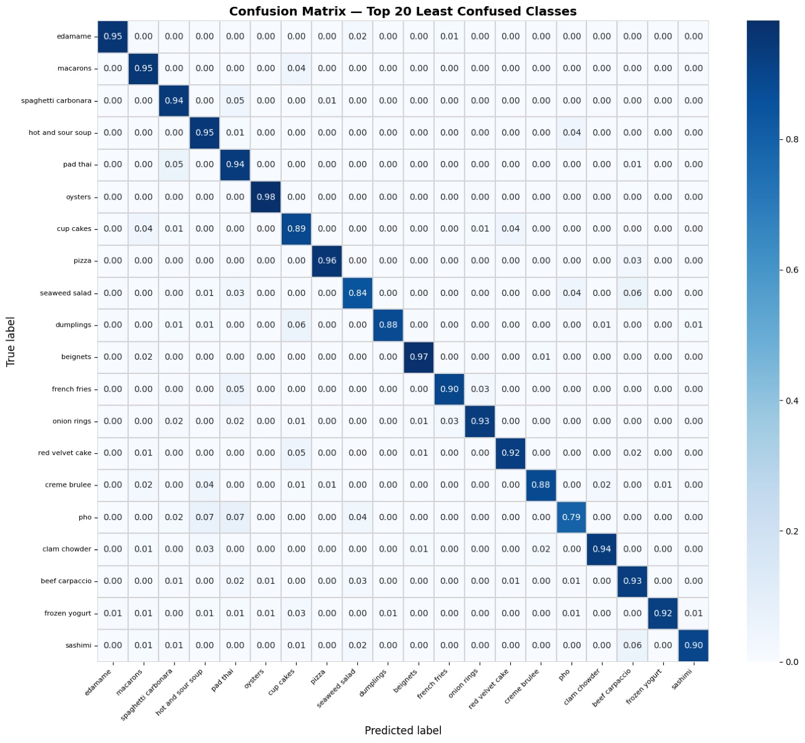
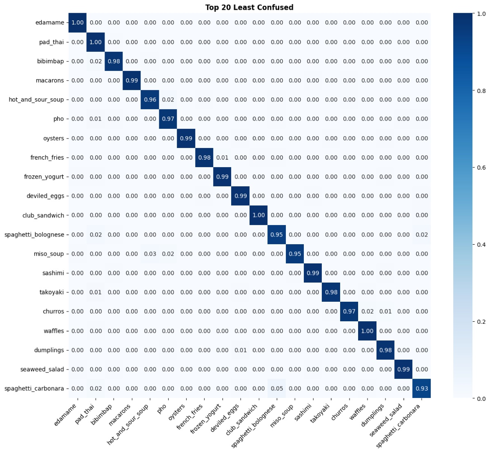
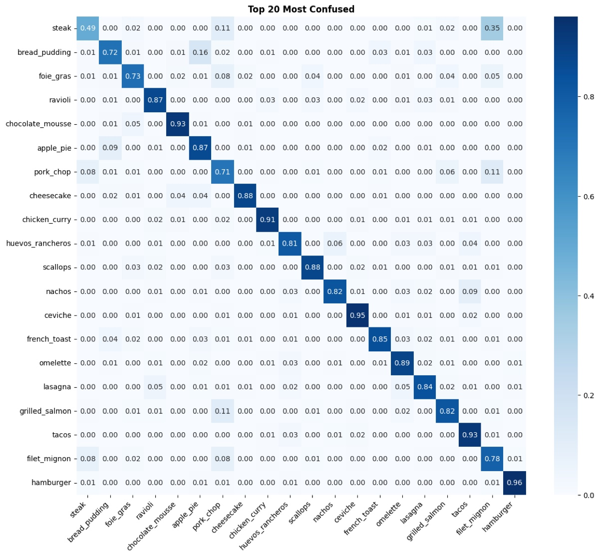

# CNN Food-101: Transfer Learning and Fine-Tuning

Image classification over the 101 food categories of [Food-101](https://data.vision.ee.ethz.ch/cvl/datasets_extra/food-101/) with PyTorch.
Three pretrained backbones are compared as frozen feature extractors, and the best one is then fine-tuned by progressively unfreezing deeper layers.



## Results at a glance

| Stage | Setup | Best validation accuracy | Test accuracy |
|---|---|---|---|
| Part A | Frozen backbones (GoogLeNet, MobileNetV3-Large, ResNet-50) + custom head | about 51 % (MobileNetV3, selected as the baseline) | – |
| Part B, exp. 1 | MobileNetV3, unfreeze last 2 backbone blocks | 65.9 % | – |
| Part B, exp. 2 | MobileNetV3, unfreeze last 4 backbone blocks | 71.5 % | – |
| **Part B, exp. 3** | **MobileNetV3, unfreeze last 6 backbone blocks** | **73.6 %** | **79.2 %** |

Fine-tuning made the difference: the frozen MobileNetV3 baseline plateaued around 51 % validation accuracy, each extra pair of unfrozen blocks improved it, and the six-block model generalised best, reaching **79.2 % top-1 accuracy on the held-out test set** across 101 classes.

## Dataset

Food-101 has 101 classes with 1,000 images each. The notebooks split the official training set into train and validation and keep the official test set untouched:

| Split | Images per class | Total |
|---|---|---|
| Train | 675 | 68,175 |
| Validation | 75 | 7,575 |
| Test | 250 | 25,250 |



## Part A: transfer learning with frozen backbones

`partA_transfer_learning.ipynb` trains three ImageNet-pretrained backbones with their weights frozen and a shared custom classification head, under the same data pipeline, augmentations and training loop so they can be compared fairly:

- GoogLeNet (Inception v1)
- MobileNetV3-Large
- ResNet-50

Learning curves for MobileNetV3:

<p>
  
  
</p>

The notebook also plots the twenty least and most confused classes for each model. ResNet-50, for example, separates visually distinct dishes almost perfectly:



## Part B: fine-tuning the best model

`partB_fine_tuning.ipynb` loads the best Part A checkpoint and runs four controlled experiments, unfreezing the last 2, 4, 6 and 8 backbone blocks with differential learning rates (smaller for the backbone, larger for the head). Only the best experiment is evaluated on the test set.

Test-set confusion for the best model. Dishes that look alike (steak, filet mignon, pork chop; bread pudding and apple pie) remain the hardest:

<p>
  
  
</p>

## Project structure

| Path | Purpose |
|---|---|
| `partA_transfer_learning.ipynb` | Dataset exploration, splits, frozen-backbone training and comparison |
| `partB_fine_tuning.ipynb` | Progressive unfreezing experiments and test evaluation |
| `utils.ipynb` | Shared setup, data pipeline, visualisation, model and training utilities |
| `checkpoints/` | Best model weights (`*.pth`) produced during training (not tracked) |
| `data/food-101/` | Dataset directory with `images/` and `meta/` (not tracked) |
| `docs/images/` | Figures used in this README |

## How to run

1. Download Food-101 and extract it to `data/food-101/`.
2. Run `partA_transfer_learning.ipynb` end to end.
3. Note the best model and make sure its checkpoint is in `checkpoints/`.
4. Set `BEST_MODEL_NAME` in `partB_fine_tuning.ipynb` and run it.

Both notebooks run locally or in Google Colab; the Colab cells persist the dataset and checkpoints on Drive.

## Environment

- Python 3.10+
- PyTorch and torchvision
- pytorch-ignite
- matplotlib, seaborn, pandas, numpy, tqdm

```bash
pip install torch torchvision matplotlib seaborn pandas numpy pytorch-ignite tqdm
```

## Reproducibility

Both notebooks fix `SEED = 42` for data shuffling and training, so splits and results are repeatable across runs.
